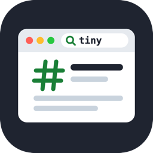

# tiny-browse

### Give any AI agent the web, in 126 kB.

tiny-browse searches **Google in the Chrome you already have**, reads the best results and returns **clean Markdown** that fits a **hard token budget**. One **zero-dependency** package: an **MCP server** for any agent and a **Node.js library** for your own code. No bundled browser, no API keys.

[](https://nodejs.org)
[](https://github.com/shubhamcodess/tiny-browse/actions/workflows/ci.yml)
[](LICENSE)

[](https://www.npmjs.com/package/@shubhamcodess/tiny-browse)
[](https://www.npmjs.com/package/@shubhamcodess/tiny-browse)
[](https://www.npmjs.com/package/@shubhamcodess/tiny-browse)

- **Any agent, any model.** MCP over stdio or HTTP, plus a JSON API. No LLM inside.
- **Tiny on disk.** A 126 kB download with zero runtime dependencies, using your installed Chrome, Edge, Brave or Chromium instead of downloading a browser of its own.
- **Answers, not HTML.** Main content only, with headings, code, tables and lists kept, inside a hard `max_tokens` limit.
- **Careful by default.** Strict search rate limits, no access to private networks, pages read without your cookies.

## Install

Requires Node.js 22+ and Chrome, Chromium, Edge or Brave (or use the no-Chrome mode).

**From npm**

```bash
npm install -g @shubhamcodess/tiny-browse
tiny-browse doctor
```

Agents can also run it without installing: `npx -y @shubhamcodess/tiny-browse mcp`.

**From the latest GitHub release**

```bash
npm install -g https://github.com/shubhamcodess/tiny-browse/releases/latest/download/tiny-browse.tgz
```

**From source**

```bash
git clone https://github.com/shubhamcodess/tiny-browse.git
cd tiny-browse
npm ci && npm run build
npm link            # or run: node dist/cli.js
```

## Use cases

**Web search for your own local agents.** An agent running on a local model has no web access. Add tiny-browse as an MCP server and it can search and read pages, with no API keys and no cloud service.

**Answers grounded in sources.** Every page comes back with its URL and only its relevant sections, so an assistant can answer from current pages and cite them instead of relying on what the model remembers.

**Current docs for coding agents.** Libraries change after a model's training cutoff. `web_fetch` with `focus` pulls just the part of the documentation the agent needs, as clean Markdown with code blocks intact.

## Connect to an agent

**Claude Code**

```bash
claude mcp add tiny-browse -- npx -y @shubhamcodess/tiny-browse mcp
```

**VS Code (GitHub Copilot)**: `.vscode/mcp.json`

```json
{
  "servers": {
    "tiny-browse": { "type": "stdio", "command": "npx", "args": ["-y", "@shubhamcodess/tiny-browse", "mcp"] }
  }
}
```

**Cursor, Claude Desktop and most other clients**

```json
{
  "mcpServers": {
    "tiny-browse": { "command": "npx", "args": ["-y", "@shubhamcodess/tiny-browse", "mcp"] }
  }
}
```

`tiny-browse config <client>` prints the setup for `claude-code`, `claude-desktop`, `cursor`, `vscode`, `codex` or `generic`. To share one warm Chrome between several agents, run `tiny-browse serve --http 7777` and connect to `http://127.0.0.1:7777/mcp`.

The agent gets two tools: **`web_search`** (search and read the top results) and **`web_fetch`** (read URLs, optionally narrowed with `focus` or continued with `cursor`). Parameters: [TOOLS.md](docs/TOOLS.md).

## Use as a dependency

```bash
npm install @shubhamcodess/tiny-browse
```

```ts
import { webSearch, webFetch } from "@shubhamcodess/tiny-browse";

const { results, pages, markdown } = await webSearch({ query: "node.js stream backpressure", read: 2 });
for (const r of results) console.log(r.rank, r.title, r.url);

const docs = await webFetch({ urls: ["https://go.dev/doc/effective_go"], focus: "goroutines", max_tokens: 2000 });
console.log(docs.pages[0].markdown);
```

Each call starts what it needs and shuts it down before returning, so short-lived CLIs exit straight away. Use `createClient()` to reuse one Chrome across calls, `mode: "http"` to skip Chrome entirely, and `TinyBrowseError.code` to handle failures. Full API: [LIBRARY.md](docs/LIBRARY.md).

## How it works

1. **Search.** Google's results page is loaded in your Chrome and read three independent ways (layout, accessibility tree, selectors), merged by vote, so a page redesign rarely breaks it. If Google is blocked or over its rate budget, DuckDuckGo and Bing are tried.
2. **Read.** Each page is fetched over plain HTTP and rendered with scripts off, which is fast; pages that need JavaScript get a full Chrome load. The faster way is remembered per site.
3. **Extract.** The main content is found by how the page is laid out, not by class names. Menus, ads, cookie banners and hidden text are dropped.
4. **Fit.** The page is split into sections by heading and packed into `max_tokens`, keeping the sections most relevant to the query.

## Limitations

- Search engines may block automated browsers, depending on your network. Running `tiny-browse login` once usually helps with Google. Reading pages is not affected.
- Sites that refuse automated access with a bot check are reported as `blocked`, never bypassed.
- No PDF support yet.
- Tested on macOS and Linux. Windows is untested.

## Troubleshooting

| Problem | Fix |
|---|---|
| `chrome_not_found` | Install Chrome, or set `--browser-path` / `TINY_BROWSE_CHROME` |
| Google keeps showing CAPTCHAs | Run `tiny-browse login`. Searches use the other engines meanwhile; `tiny-browse doctor` shows pauses and budgets |
| Chrome won't start on Ubuntu 24.04 | `sudo sysctl -w kernel.apparmor_restrict_unprivileged_userns=0` |
| `port … is already in use` | Another `tiny-browse serve` is running: stop it or choose another port |
| A page comes back thin | Use `render: "browser"`; the site may need JavaScript or block automation |

## Documentation

| | |
|---|---|
| [Configuration](docs/CONFIGURATION.md) | Settings, rate limits, environment variables, flags |
| [MCP tools and server](docs/TOOLS.md) | Tool parameters, output, HTTP server |
| [Library API](docs/LIBRARY.md) | Functions, options, errors, lifecycle |
| [Design notes](docs/DESIGN.md) | Architecture and findings |
| [Contributing](CONTRIBUTING.md) | Development setup and releases |
| [Security](SECURITY.md) | Reporting vulnerabilities, threat model |
| [Code of Conduct](CODE_OF_CONDUCT.md) | |
| [Changelog](CHANGELOG.md) | |

## License

[MIT](LICENSE) © Shubham Prakash
